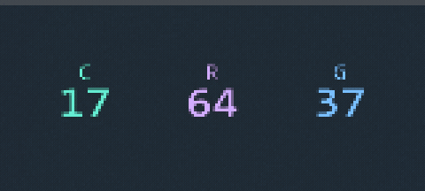
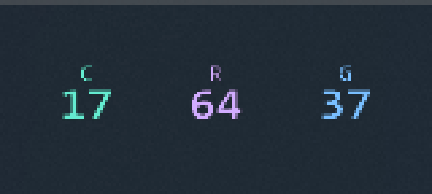
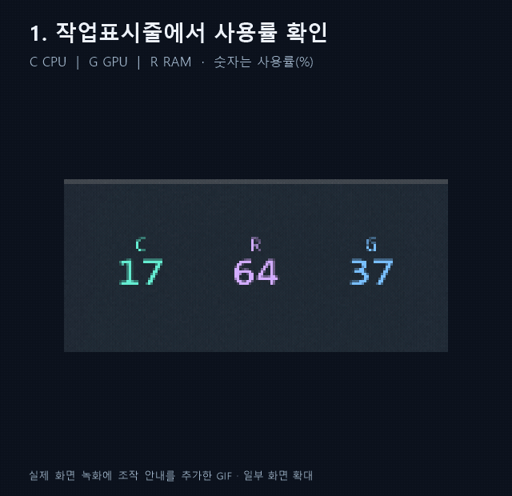

# Pulse 1.1.1 — 작업표시줄 숫자 모니터

**Windows 작업표시줄에서 CPU·GPU·RAM 사용률을 실시간으로 보여주는 작은 시스템 모니터**

평소에는 시계 옆 숫자 아이콘 3개로 상태를 확인하고, 자세한 수치가 필요할 때만 상세 창을 연다.



실행 중인 프로그램을 8초간 촬영한 GIF다. 작은 숫자를 읽기 쉽도록 3배 확대했다.
아이콘 순서는 Windows 설정에 따라 달라지며, 촬영 화면은 C / R / G 순서다.

Windows 11 x64, .NET Framework 4.8 이상용 초기 버전이다.
현재 한 대의 PC에서 실행을 검증했으며, 다른 PC와 AMD GPU, Windows ARM64에서의 동작은 검증하지 않았다.
표시 가능한 온도·전력·팬 항목은 장치와 설치된 드라이버, 센서 공급자에 따라 달라진다.

- C: CPU 사용률(%) — 민트색
- G: 선택한 GPU 사용률(%) — 파란색
- R: RAM 사용률(%) — 보라색

숫자는 반올림한 사용률이다. 예를 들어 C 12는 CPU 사용률 약 12%를 뜻한다.
센서가 없거나 갱신이 멈추면 0으로 대체하지 않고 `--`를 표시한다.

## 설치 방법

별도 설치 마법사가 없는 **압축 해제형 프로그램**이다. 기본 기능은 인터넷 연결과 관리자 권한 없이 동작한다.

1. 배포 파일 **`PulseWidget-windows-x64.zip`**을 다운로드한다.
   배포 파일이 아직 게시되지 않았다면 아래의 **소스에서 빌드하기**를 이용한다.
   GitHub의 `Code → Download ZIP`은 실행파일이 아닌 소스 코드다.
2. ZIP 파일을 우클릭하고 **모두 추출**을 선택한다. 압축파일 안에서 바로 실행하지 않는다.
3. 압축을 푼 폴더에서 **`PulseWidget.exe`**를 더블클릭한다. 파일 유형은 **응용 프로그램**이다.
4. **`PulseWidget.exe.config`를 실행파일과 같은 폴더에 둔다.** 실행파일만 따로 옮기지 않는다.
5. 작업표시줄 오른쪽에 C / G / R 숫자가 생겼는지 확인한다. 숨겨져 있으면 아래 안내에 따라 꺼낸다.

처음부터 큰 창이 뜨지 않는 것이 정상이다. 같은 앱을 다시 실행해도 중복 실행되지 않는다.
Windows ARM64와 Windows 10은 현재 검증 대상에 포함되지 않는다.

### 숫자가 숨겨져 있다면

작업표시줄 오른쪽 **`^`**를 누른 뒤 C / G / R 숫자 아이콘을 작업표시줄로 끌어낸다.
또는 **Windows 설정 → 개인 설정 → 작업표시줄 → 기타 시스템 트레이 아이콘**에서
현재 실행 중인 **Pulse System Widget** 항목 3개를 켠다. Windows 버전에 따라 메뉴 이름이 조금 다를 수 있다.



## 사용 방법



실제 작업표시줄과 상세 창의 녹화 화면에 조작 설명을 붙인 12초 안내 GIF다.
설정 창 내부를 조작하는 연속 녹화가 아니라, 버튼 위치와 사용 순서를 보여주는 안내다.

| 하고 싶은 일 | 조작 |
| --- | --- |
| 사용률을 빠르게 확인 | 작업표시줄 C / G / R 숫자 확인 |
| 간단한 상세 수치 확인 | 숫자 아이콘에 마우스 올리기 |
| 상세 창 열기 / 닫기 | 숫자 클릭 또는 `Ctrl + Alt + P` |
| 상세 창 닫기 | 창 바깥 클릭 또는 `Esc` |
| 센서·GPU·갱신 주기 설정 | 숫자 우클릭 메뉴 또는 상세 창의 `···` |
| 추가 센서 펼치기 | 상세 창의 `⌄` |
| 프로그램 종료 | 숫자 우클릭 → 종료 |

1. `PulseWidget.exe`를 실행한다. 옆의 `PulseWidget.exe.config`를 함께 보관한다.
2. 숫자 아이콘에 마우스를 올리면 자세한 사용량·온도 등을 볼 수 있다.
3. 숫자를 클릭하면 작은 상세 창이 열린다. 다른 창을 누르면 닫힌다.
4. 숫자를 우클릭하면 센서 선택, 갱신 주기, 자동 실행, 종료 메뉴가 열린다.
5. Ctrl+Alt+P로도 상세 창을 열고 닫을 수 있다. 다른 프로그램이 이 단축키를 이미 사용하면 숫자 아이콘을 이용한다.

상세 창의 화살표는 추가 센서 펼치기, `···`는 설정이다. 추가 센서가 많으면 마우스 휠로 스크롤한다.
프로그램은 기본으로 바탕화면 창이나 일반 작업표시줄 앱 버튼을 표시하지 않는다.
숫자 아이콘은 항상 존재하지만 작업표시줄 자체를 자동 숨김으로 설정하면 작업표시줄과 함께 숨겨진다.

## 숫자가 ^ 안에 숨겨진 경우

Windows 설정 → 개인 설정 → 작업표시줄 → 기타 시스템 트레이 아이콘에서 현재 Pulse System Widget 항목을 켠다.
또는 숨겨진 아이콘 영역에서 숫자를 시계 옆으로 끌어낸다. 과거 버전의 사용하지 않는 항목이 남을 수 있다.
이 PC에서는 실행 중인 숫자 아이콘 3개를 표시하도록 설정했고, 재실행 후 위치 유지도 확인했다.
아이콘 순서는 Windows에서 바꿀 수 있다. 글자 C/G/R로 구분한다.

아이콘 이미지는 기본 16×16, 현재 150% 배율에서는 24×24 픽셀이다. Windows가 주변 클릭 여백을 배정한다.
탐색기에 코드를 삽입하거나 작업표시줄 파일을 수정하지 않고 정식 알림 영역 기능을 사용한다.

## 상세 센서와 제한

CPU 사용률은 Windows GetSystemTimes, RAM은 GlobalMemoryStatusEx에서 읽는다.
NVIDIA GPU는 이미 설치된 드라이버의 NVML로 사용률·온도·전용 메모리·클럭·전력을 읽는다.
Intel 등 다른 GPU는 DXGI 장치 식별자와 Windows GPU 성능 계수를 연결하여 읽는다.
내장 GPU의 공유 메모리를 전용 메모리에 더하지 않는다.
네트워크는 선택한 연결의 초당 바이트이며 메모리 단위 GB/MB/KB는 1024 기준이다.
CPU의 Windows 보고 클럭은 장치에 따라 기준 주파수처럼 고정될 수 있다.

CPU 온도, 팬 RPM, 저장장치 온도, CPU 전력은 실행 중인 호환 Libre Hardware Monitor / Open Hardware Monitor의 로컬 WMI 공급자가 있어야 읽을 수 있다.
현재 PC에는 해당 공급자가 없어 CPU 온도가 미지원으로 표시된다. GPU 핫스폿은 현재 수집 경로에 구현되어 있지 않다.
외부 WMI 공급자의 GPU 센서는 GPU를 잘못 연결하지 않도록 가져오지 않는다.
센서 드라이버를 설치하거나 관리자 실행을 자동 요청하지 않는다.

미지원, 권한 부족, 읽기 실패를 구분하며 마지막 정상 값을 무한히 표시하지 않는다.
외부 공급자가 자체 측정 시각을 제공하지 않으면 공급자 내부의 값 정지까지 판단할 수는 없다.

## 설정·자동 실행·제거

설정은 `%LOCALAPPDATA%\PulseWidget\settings.json`에 저장한다.
자동 실행은 메뉴에서 사용자가 켰을 때만 현재 사용자 Run의 PulseWidget 항목에 등록한다.

`HKCU\Software\Microsoft\Windows\CurrentVersion\Run\PulseWidget`

제거하려면 자동 실행을 켰다면 먼저 끄고, 메뉴에서 종료한 다음 배포 폴더를 삭제한다.
설정도 삭제하려면 `%LOCALAPPDATA%\PulseWidget`을 삭제한다. 이 앱이 설치한 서비스나 드라이버는 없다.

## 소스에서 빌드하기

1.1.1부터 실행파일과 설정 창에 전용 파형 아이콘이 포함된다.
아이콘은 assets/PulseWidget.ico에 16, 20, 24, 32, 40, 48, 64, 128, 256 픽셀로 들어 있다.
외부 이미지 라이브러리 없이 create-icon.ps1로 같은 아이콘을 다시 생성할 수 있다.
빌드는 /win32icon으로 실행파일 아이콘을 넣고, 창 아이콘은 내장 리소스에서 불러온다.
작업표시줄의 C/G/R 실시간 숫자 아이콘은 기존 방식으로 유지한다.

Windows 11 x64와 .NET Framework 4.8 이상을 사용한다. 추가 패키지 설치 없이 빌드한다.

```powershell
./system-monitor-widget/build.ps1
```

이 프로젝트 폴더만 내려받은 경우에는 해당 폴더에서 다음과 같이 빌드한다.
`dist`에 생긴 실행파일과 `.exe.config`를 함께 배포한다.

```powershell
./build.ps1 -OutputDirectory ./dist
./dist/PulseWidget.exe
```

진단은 기존 실행 중인 Pulse를 종료한 상태에서 실행한다.

```powershell
./outputs/system-monitor-widget/PulseWidget.exe --diagnostics C:/temp/pulse-tray.json
```

진단 파일은 센서 값, 창 표시 상태, 실제 Shell_NotifyIconGetRect 좌표를 기록한다.
`tray-preview.png`와 `tray-popup-preview.png`는 실행 중인 앱이 그린 결과를 내보낸 이미지이며 전체 화면 스크린샷이 아니다.
일반 실행은 진단 이미지를 기록하지 않는다. 소스의 tests/verify-runtime.ps1로 프로세스 자원을 측정할 수 있다.

구현 전 구버전은 별도 `PulseWidget-before-tray-날짜.zip`으로 백업했다.
이번 검증 결과는 TRAY-QA-REPORT.md, 이전 큰 위젯의 과거 기록은 QA-REPORT.md에 있다.

## 자주 묻는 질문

**R 숫자는 이 프로그램이 쓰는 RAM인가요?**

아니다. PC 전체의 물리 RAM 사용률이다. 예를 들어 R 64는 전체 RAM의 약 64%가 사용 중이라는 뜻이다.

**CPU 온도가 미지원으로 나옵니다.**

현재 수집 방식은 호환 센서 공급자가 필요하다. 미지원은 0°C라는 뜻이 아니다.
온도를 표시하려고 보안 기능을 끄거나 출처가 불명확한 드라이버를 설치하지 않는다.

**로그인할 때 자동으로 켜지게 할 수 있나요?**

숫자 우클릭 메뉴에서 Windows 로그인 시 자동 실행을 켠다. 기본값은 꺼짐이다.
등록 후 프로그램 폴더를 옮겼다면 새 위치에서 자동 실행을 껐다가 다시 켠다.

**다른 PC에서도 사용할 수 있나요?**

Windows 11 x64와 .NET Framework 4.8 이상을 대상으로 만들었다.
현재 실행 검증은 한 대의 PC에서 수행했으며, 장치마다 센서 지원 범위가 다르다.
